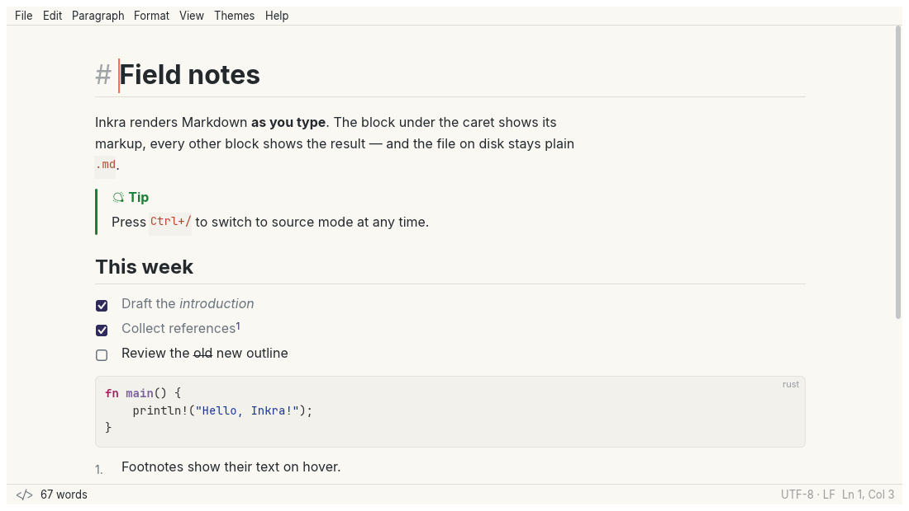
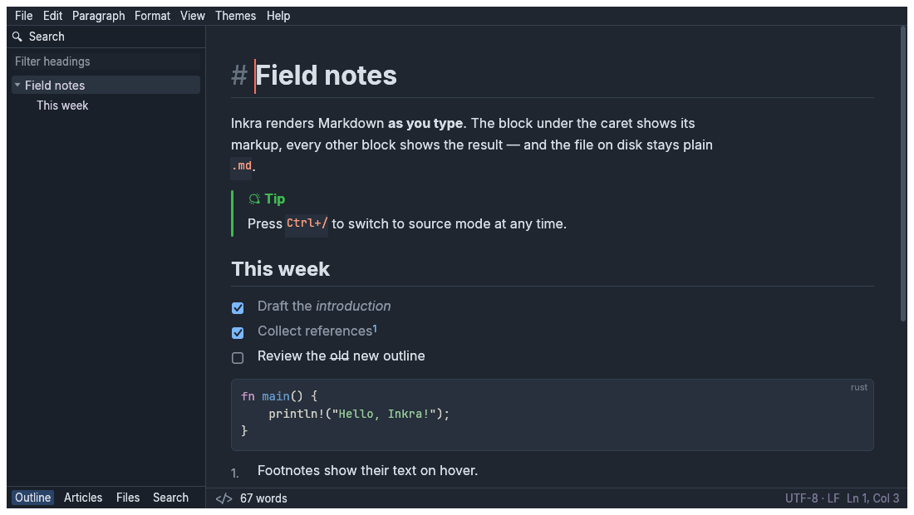
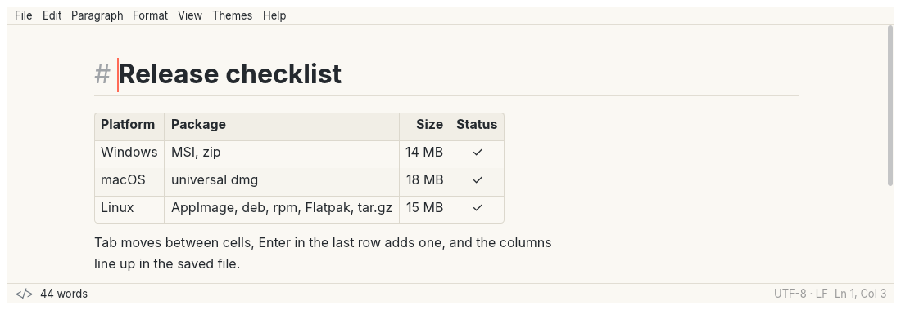
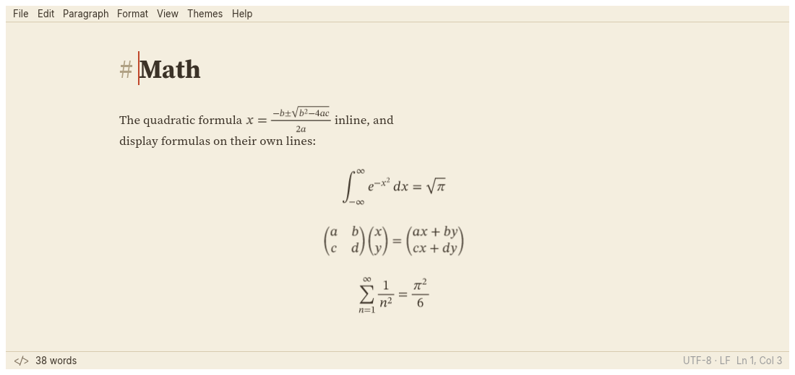
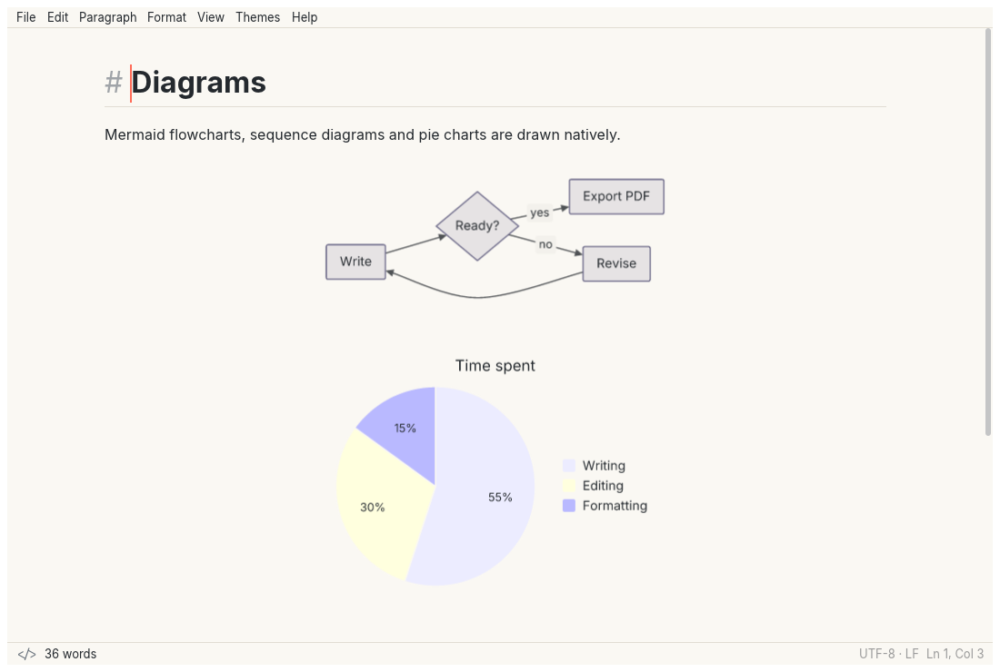

<p align="center"></p>

# Inkra（墨刻）

原生、轻量的所见即所得 Markdown 编辑器。100% Rust：界面由 egui 在 GPU 上自绘，排版、语法高亮、数学公式、图表、PDF 生成全部为原生实现，不内嵌浏览器内核，不依赖 JavaScript 运行时。

- 单视图实时渲染：光标所在块显示 Markdown 标记，其他块显示排版结果；磁盘上始终是标准 `.md`。
- 文档的唯一真相是源码 rope，所有编辑都是可撤销的 Transaction。
- 每个动作都是一个命令（`docs/commands.md`），菜单、快捷键、CLI 都只是入口。

> **1.0.0-beta.1 是公开测试版。** 功能已完整，但还需要真实文档与真实机器上的反馈，见下文"已知限制"与"反馈问题"。

<p align="center"></p>

| | |
|---|---|
|  |  |
|  |  |
|  | |

截图由 `ui_shot` 从 [`docs/images/src/`](docs/images/src/) 中的文档离屏渲染，命令见 [`docs/images/README.md`](docs/images/README.md)。

## 下载

从 [GitHub Releases](https://github.com/CIPFZ/inkra/releases) 下载，`SHA256SUMS.txt` 列出每个文件的校验和。安装包未做代码签名（签名与公证在 1.x 路线图中）。

| 平台 | 文件 | 说明 |
|---|---|---|
| Windows 10 1809+ x64 | `inkra-<版本>-x64.msi`、`inkra-<版本>-windows-x64.zip` | MSI 注册 `.md` 等文件关联与开始菜单；zip 解压即用 |
| Windows 10 1809+ arm64 | `inkra-<版本>-arm64.msi`、`inkra-<版本>-windows-arm64.zip` | 同上 |
| macOS 12+（Intel 与 Apple 芯片） | `Inkra-<版本>-universal.dmg` | 未签名：首次打开请在 Finder 中右键 → 打开 |
| Linux x86_64 | `Inkra-<版本>-x86_64.AppImage`、`inkra_<版本>_amd64.deb`、`inkra-<版本>-1.x86_64.rpm`、`inkra-<版本>-x86_64.flatpak`、`inkra-<版本>-linux-x86_64.tar.gz` | deb 需要 glibc 2.35+（Ubuntu 22.04、Debian 12 起）；tar.gz 内含 `install.sh` |
| Linux arm64 | `Inkra-<版本>-arm64.AppImage`、`inkra_<版本>_arm64.deb`、`inkra-<版本>-1.aarch64.rpm`、`inkra-<版本>-arm64.flatpak`、`inkra-<版本>-linux-arm64.tar.gz` | 同上 |

`<版本>` 形如 `1.0.0-beta.1`。

## 已知限制（1.0.0-beta.1）

- **彩色 emoji**：emoji 以单色字形显示（内置 Noto Emoji）；egui 文字管线尚不能绘制彩色字形。
- **Windows 11 贴靠布局**：一体化标题栏的最大化按钮不弹出贴靠布局浮层；需要时可在偏好设置中改用系统标题栏（`appearance.titleBar`）。
- **Wayland**：默认经 XWayland 运行（Wayland 下 winit 收不到拖放的文件）；`INKRA_WAYLAND=1` 强制原生 Wayland，尚未在 Wayland 会话中实测。
- 安装包未签名；Windows SmartScreen 与 macOS Gatekeeper 会在首次运行时提示。
- 冷启动在虚拟 GPU 环境中约 360 ms（DX12 会逐个探测全部显卡），单 GPU 实体机的数据还在收集。

## 反馈问题

请在 [Issues](https://github.com/CIPFZ/inkra/issues) 中选择模板提交，并附上：

1. 日志 `inkra.log`（不含文档内容）：Windows `%LOCALAPPDATA%\Inkra\logs\`、macOS `~/Library/Application Support/Inkra/logs/`、Linux `~/.local/share/inkra/logs/`。
2. 日志中以 `graphics:` 开头的一行（显卡与渲染后端）。
3. 能重现问题的最小 `.md` 文件（解析或渲染问题尤其需要）。

需求与设计见 [`docs/SPEC.md`](docs/SPEC.md)，进度见 [`docs/PROGRESS.md`](docs/PROGRESS.md)，路线图见 [`docs/ROADMAP.md`](docs/ROADMAP.md)。在本仓库工作的 AI 代理请先读根目录的 [`AGENT.md`](AGENT.md)。

## 构建

需要 Rust stable（2024 edition，≥ 1.98）。

```sh
cargo run -p inkra                 # 启动桌面应用
cargo run -p inkra -- --version
cargo run --release -p inkra -- --measure-startup   # 打印到首帧呈现的耗时
cargo run -p inkra-cli -- --help
cargo xtask ci                     # fmt + clippy -D warnings + test + layering + 生成文档检查
cargo xtask docs                   # 重新生成 docs/commands.md、preferences.md、keybindings.md
cargo xtask bundle-macos --release # 生成 target/release/Inkra.app
cargo xtask dist                   # 本平台安装包到 target/dist（Linux：tar.gz/deb/rpm/AppImage；Windows：zip/MSI；macOS：app/dmg）
```

命令行（CM-002）：

```sh
inkra-cli convert doc.md doc.pdf          # 也支持 .html .png .jpg；装有 Pandoc 时 .docx .odt .epub .tex 等
inkra-cli inspect doc.md --json           # 标题、链接、图片、字数
inkra-cli lint doc.md                     # 断链、缺图、未闭合围栏、未定义脚注
inkra-cli fmt doc.md --write              # 规范化表格、编号、空白
inkra-cli run doc.md --cmd edit.selectAll --cmd format.bold --save out.md
```

打包工具（可选）：Linux `rpmbuild`、`appimagetool`；Windows WiX Toolset 3（`candle`/`light` 在 PATH 或 `WIX` 指向其目录）；macOS `hdiutil`。

平台依赖：

- Linux：`libxkbcommon`、`libwayland`、X11 开发库，以及 Vulkan 或 GL 驱动（Mesa 即可）。
- Windows：MSVC 生成工具与 Windows SDK（嵌入图标资源需要 `rc.exe`）。
- macOS：Xcode 命令行工具。

## 目录结构

```
crates/
  inkra-text        L0  rope 封装、偏移换算、Unicode 分词、编码与换行符
  inkra-i18n        L0  fluent 资源加载（横切，可被任意层依赖）
  inkra-markdown    L1a 自研增量 Markdown 解析器、AST、无损序列化
  inkra-doc         L1b 文档模型：rope + AST 缓存、Transaction、撤销栈
  inkra-highlight   L2  syntect 代码高亮
  inkra-math        L2  TeX 数学排版
  inkra-diagram     L2  Mermaid 子集
  inkra-html        L2  HTML ↔ Markdown
  inkra-layout      L3a 文档排版、命中测试、布局缓存
  inkra-render      L3b 布局树 → egui Shape、离屏位图
  inkra-export      L4  PDF / HTML / 图片导出、Pandoc 桥接
  inkra-workspace   L4  路径、原子写入、日志、文件树、监控、搜索、会话
  inkra-engine      L5  命令系统、编辑器状态机、偏好设置、主题、快捷键、菜单模型
  inkra-ui          L6  egui 前端
apps/
  inkra             桌面应用
  inkra-cli         命令行
xtask/              ci、layering、文档生成、打包
assets/brand/       应用图标包（由 tools/build_icons.py 生成）
docs/               SPEC、架构、命令目录、偏好与快捷键表、进度
```

分层规则（`cargo xtask layering` 机器检查）：上层可依赖下层，下层禁止依赖上层，同层禁止互相依赖；详见 [`docs/architecture.md`](docs/architecture.md)。

## 许可证

MIT OR Apache-2.0，见 `LICENSE-MIT` 与 `LICENSE-APACHE`。应用图标为项目原创，随代码以相同许可证发布。
