# 图表语料（M5 验收）

M5 验收要求 Mermaid 官方文档风格的 flowchart 示例 30 个全部渲染
（`cargo test -p inkra-diagram corpus`；对照图：`cargo run -p inkra-diagram --example render -- out.png`）。
另附 sequence 与 pie 示例。

## Flowchart

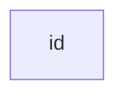

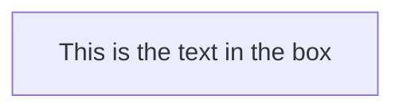

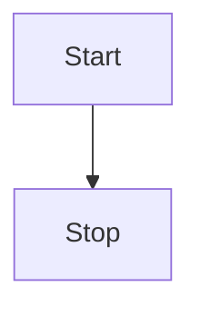

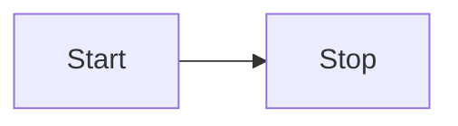

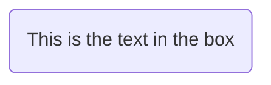


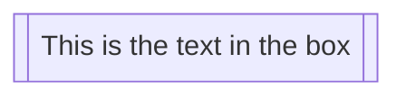

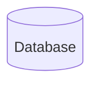

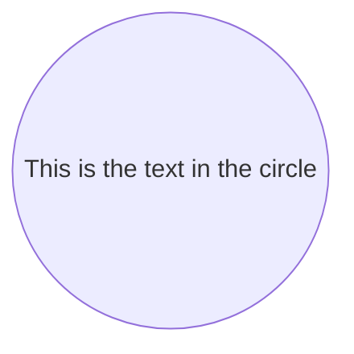

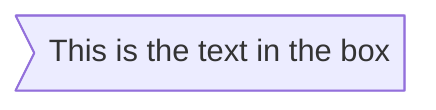

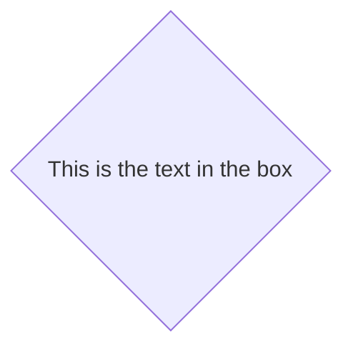


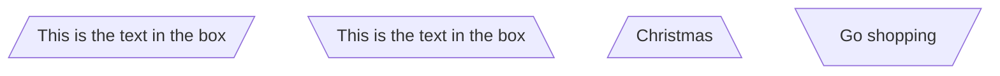

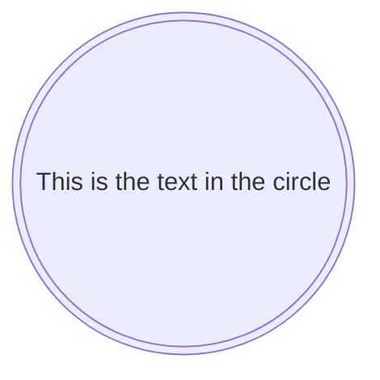

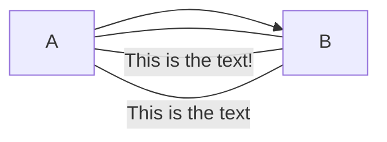

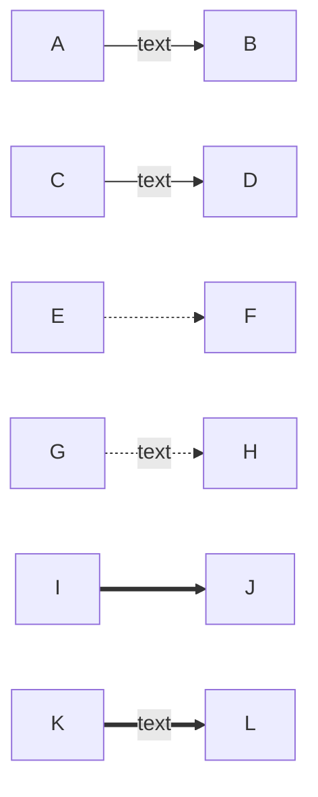

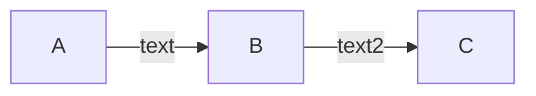

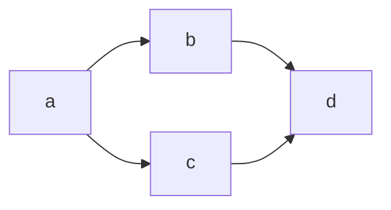

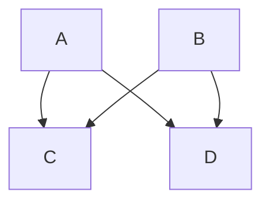

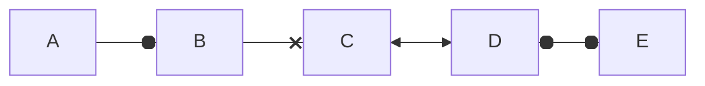

```mermaid
flowchart TD
    A[Start] --> B{Is it?}
    B -->|Yes| C[OK]
    C --> D[Rethink]
    D --> B
    B ---->|No| E[End]
```

```mermaid
flowchart TB
    c1-->a2
    subgraph one
    a1-->a2
    end
    subgraph two
    b1-->b2
    end
    subgraph three
    c1-->c2
    end
```

```mermaid
flowchart TB
    c1-->a2
    subgraph ide1 [one]
    a1-->a2
    end
```

```mermaid
flowchart TB
    c1-->a2
    subgraph one
    a1-->a2
    end
    subgraph two
    b1-->b2
    end
    subgraph three
    c1-->c2
    end
    one --> two
    three --> two
    two --> c2
```

```mermaid
graph TD
    A[Christmas] -->|Get money| B(Go shopping)
    B --> C{Let me think}
    C -->|One| D[Laptop]
    C -->|Two| E[iPhone]
    C -->|Three| F[Car]
```

```mermaid
flowchart LR
    A[Hard edge] -->|Link text| B(Round edge)
    B --> C{Decision}
    C -->|One| D[Result one]
    C -->|Two| E[Result two]
```

```mermaid
flowchart LR
    id1(Start)-->id2(Stop)
    style id1 fill:#f9f,stroke:#333,stroke-width:4px
    style id2 fill:#bbf,stroke:#f66,stroke-width:2px
```

```mermaid
flowchart BT
    A --> B --> C
    A --> C
```

```mermaid
flowchart RL
    A["A double quote:#quot;"] --> B["用户登录"]
    B --> C{"验证通过？"}
    C -->|是| D[进入首页]
    C -->|否| B
```

```mermaid
flowchart TD
    A[Start] --> B[Load config]
    B --> C{Config valid?}
    C -- yes --> D[Open window]
    C -- no --> E[Use defaults]
    E --> D
    D --> F[Restore session]
    F --> G((Ready))
    %% a comment
    G -.-> H[Idle]
    H ==> G
```

## Sequence

```mermaid
sequenceDiagram
    Alice->>John: Hello John, how are you?
    John-->>Alice: Great!
    Alice-)John: See you later!
```

```mermaid
sequenceDiagram
    participant A as Alice
    participant J as John
    autonumber
    A->>+J: Hello John, how are you?
    J->>+A: Fine, thanks
    loop Every minute
        J-->>A: Still here
    end
    alt is sick
        A->>J: Not so good :(
    else is well
        A->>J: Feeling fresh like a daisy
    end
    Note right of J: Rational thoughts
    Note over A,J: A typical interaction
    A-->>-J: Bye
    J-xA: closed
```

```mermaid
sequenceDiagram
    actor U as 用户
    participant S as 服务器
    U->>S: 登录请求
    S-->>U: 返回令牌
    par 并行
        U->>S: 拉取资料
    and
        U->>S: 拉取消息
    end
```

## Pie

```mermaid
pie title Pets adopted by volunteers
    "Dogs" : 386
    "Cats" : 85
    "Rats" : 15
```

```mermaid
pie showData
    title Key elements in Product X
    "Calcium" : 42.96
    "Potassium" : 50.05
    "Magnesium" : 10.01
    "Iron" :  5
```
