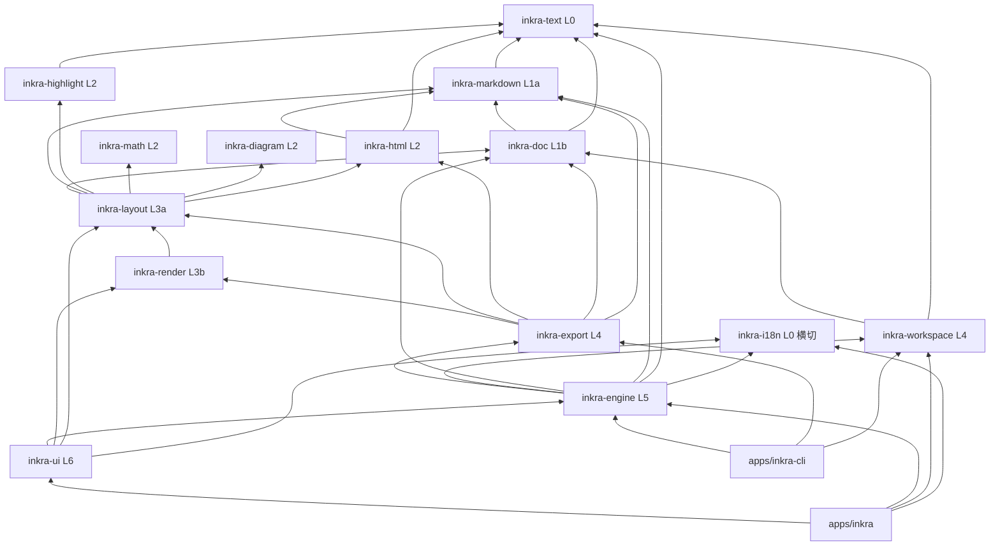

# Inkra 架构

本文是 SPEC 第 2 章的实现视图。分层表的唯一机器可读来源是 `xtask/src/layering.rs`，`cargo xtask layering` 在 CI 中检查。

## 分层



规则：

1. 依赖只能指向严格更低的 `(层, 子层)`。同一 SPEC 层内用子层表达必要的顺序：`inkra-markdown`(L1a) < `inkra-doc`(L1b)，`inkra-layout`(L3a) < `inkra-render`(L3b)（SPEC 2.2 回填）。其余同层 crate 互不依赖。
2. `inkra-i18n` 是横切 crate：任何层可依赖它，它不依赖任何内部 crate。
3. `inkra-cli` 禁止依赖 `inkra-ui`（CLI 必须无头运行）；`inkra-engine` 不依赖任何 GUI crate。
4. 全部 6 个原生目标三元组的完整依赖图中不得出现 WebView / wasm-bindgen / JS 引擎类 crate。
5. `pulldown-cmark`、`comrak` 等只读解析器只能作为 dev-dependency（AD-1）。
6. 每个成员使用 `[lints] workspace = true`（`forbid(unsafe_code)`）；唯一例外是 `apps/inkra` 的 Windows FFI 模块。
7. 直接依赖必须在 `xtask/src/deps.rs` 的审查清单中（含许可证与理由）。

## 各 crate 职责

| Crate | 层 | 职责 |
|---|---|---|
| `inkra-text` | L0 | rope 封装、字符/行/字节偏移换算、Unicode 分词、编码检测、换行符 |
| `inkra-i18n` | L0 横切 | 嵌入的 fluent 资源，`en-US` 回退，缺失键返回键名不 panic |
| `inkra-markdown` | L1a | 自研块级 + 行内增量解析器，带精确源码范围的 AST，无损序列化 |
| `inkra-doc` | L1b | `Document` = rope + AST 缓存 + 脏区；`Transaction`；撤销栈 |
| `inkra-highlight` | L2 | syntect 封装、语言别名表、延迟加载 |
| `inkra-math` | L2 | TeX 子集：解析 → 盒子布局 → 绘制指令 |
| `inkra-diagram` | L2 | Mermaid 子集解析与布局 → 矢量绘制指令 |
| `inkra-html` | L2 | HTML ↔ Markdown：粘贴转换、HTML 导出、内联 HTML 子集 |
| `inkra-layout` | L3a | 块 → 布局树（行、盒子、表格网格、分页），命中测试，布局缓存 |
| `inkra-render` | L3b | 布局树 → egui Shape；离屏渲染为位图 |
| `inkra-export` | L4 | PDF（krilla）、HTML、图片导出；Pandoc 桥接；导入 |
| `inkra-workspace` | L4 | 平台目录、原子写入、滚动日志、文件树、监控、搜索、最近文件、会话、自动保存、恢复 |
| `inkra-engine` | L5 | 命令注册表、编辑器状态机、偏好设置、主题加载、快捷键映射、菜单数据表 |
| `inkra-ui` | L6 | egui 前端：窗口、侧边栏、编辑画布、菜单、对话框、工具栏、状态栏 |
| `inkra` | app | 参数解析、日志初始化、eframe 窗口、平台胶水 |
| `inkra-cli` | app | `convert`、`inspect`、`lint`、`fmt`、`run`、`commands` |
| `xtask` | tool | `ci`、`layering`、`commands`/`prefs`/`keybindings` 文档生成、打包 |

## 命令系统（AD-3、CM-001）

```rust
pub trait Command: Send + Sync + 'static {
    fn spec(&self) -> &CommandSpec;                 // id, category, req, params schema, undo_group
    fn enabled(&self, cx: &CommandContext) -> bool;
    fn checked(&self, cx: &CommandContext) -> Option<bool>;
    fn run(&self, cx: &mut CommandContext, params: &Value) -> CommandResult;
}
```

- 标题是 i18n 键 `cmd-<id 中的 . 换成 ->`。
- `CommandRegistry::execute` 在命令边界 `catch_unwind`，panic 记日志并产生"操作失败"提示（NF-002）。
- 引擎不直接操作窗口：命令把 `Effect`（退出、显示关于、通知……）放进上下文，由宿主（UI 或 CLI）执行。
- 菜单（`inkra-engine::menu::MENU_BAR`）与快捷键（`keymap::Keymap::defaults`）只引用命令 id；未注册的命令在菜单中置灰。

## 线程模型（AD-5）

UI 线程只做输入、增量解析、可见区域布局与绘制；图片解码、高亮语法加载、公式与图表布局、搜索、导出、文件监控在后台线程，通过 channel 回传并 `request_repaint()`。
