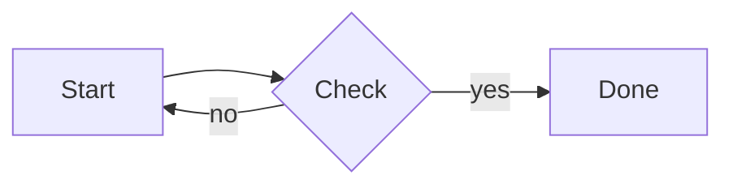

# Markdown Reference

Inkra supports CommonMark and GitHub Flavored Markdown (GFM) plus math, diagrams, footnotes and more. Move the caret onto an example below to see its source.

[TOC]

## Paragraphs and line breaks

A blank line starts a new paragraph. Two spaces or `\` at the end of a line make a hard line break.

## Headings

# Heading 1
## Heading 2
### Heading 3

## Emphasis

**Bold**, *italic*, ***bold italic***, ~~strikethrough~~, `inline code`.
When enabled in Preferences also ==highlight==, H~2~O (subscript) and x^2^ (superscript).

## Lists

- Bullet list
  - Nested item
1. Ordered list
2. Second item

- [x] Done task
- [ ] Open task (click the box to toggle)

## Quotes and alerts

> A quote.

> [!NOTE]
> Alerts: NOTE, TIP, IMPORTANT, WARNING, CAUTION.

## Links and images

[A link](https://example.com), <https://example.com>, [jump to "Tables"](#tables).


## Code

```rust
fn main() {
    println!("Hello, Inkra!");
}
```

## Tables

| Left | Center | Right |
|:-----|:------:|------:|
| a    |   b    |     c |

## Math

Inline math $e^{i\pi} + 1 = 0$ (turn on inline math in Preferences).

$$
\int_0^\infty e^{-x^2}\,dx = \frac{\sqrt{\pi}}{2}
$$

## Diagrams



`sequenceDiagram` and `pie` are supported too; other types can use the Mermaid CLI (`mmdc`).

## Footnotes

Here is a footnote[^1].

[^1]: The footnote text; hover the reference to read it.

## Table of contents

`[TOC]` on a line of its own lists the document's headings.

## Horizontal rule

---

## Emoji

`:smile:` shows as :smile:; type `:` and two letters for completion.

## HTML

Common HTML works: <kbd>Ctrl</kbd>, <mark>marked</mark>, <span style="color: #c0392b">colored text</span>, `<details>`, `` and more. Scripts never run.

## Front matter

A YAML block between `---` lines at the top; `title` and `author` are used by exports.
